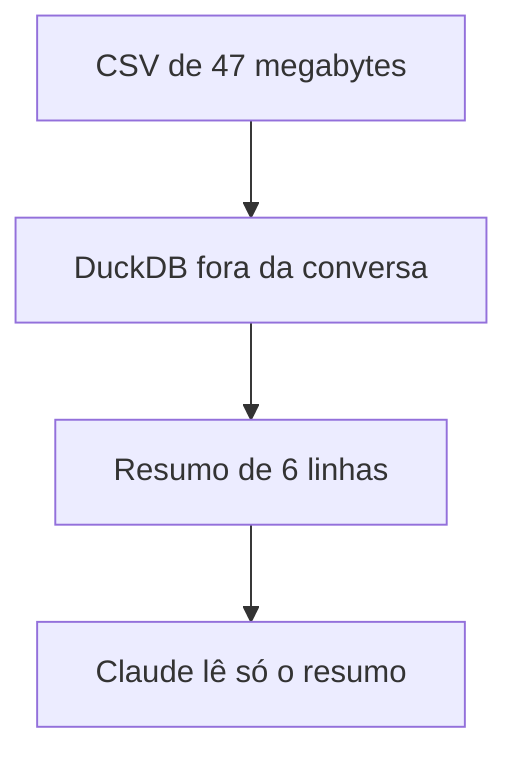

# DuckDB, formatos de arquivo, notebook e Hugging Face: do zero ao uso diário

Este guia explica os formatos CSV, JSON, JSONL e Parquet, o DuckDB, o notebook Jupyter e o Hugging Face.  
Ele importa agora porque o Claude Code usa o DuckDB para ler arquivos grandes, e cada peça explica uma parte do que ele faz.

## Um arquivo guarda a tabela por linha ou por coluna, e isso decide a velocidade

Uma tabela é uma grade: cada linha é uma coisa inteira (um pedido) e cada coluna é uma característica de todas (a cidade).  
Um formato é a regra de como escrever essa tabela dentro de um arquivo.  
A regra decide quanto o computador lê quando você pergunta algo.

### CSV, JSON e JSONL escrevem a tabela linha por linha

No CSV (comma-separated values, valores separados por vírgula), cada linha do arquivo é uma linha da tabela.  
A vírgula separa as colunas, e a primeira linha traz os nomes das colunas.  
Tudo é texto, então o arquivo não diz se "564.31" é um número ou uma palavra.  
O documento técnico RFC 4180 registra que nunca existiu uma regra formal para o CSV, e por isso cada programa grava de um jeito.

O JSON (JavaScript Object Notation) é uma ficha em que cada valor tem uma etiqueta, como "cidade": "Recife".  
Uma ficha pode guardar uma lista e pode morar dentro de outra ficha.  
O custo é o tamanho, porque cada ficha repete todas as etiquetas.  
O settings.json e o .mcp.json do Claude Code são arquivos JSON.

O JSONL (JSON Lines) coloca uma ficha JSON completa em cada linha do arquivo.  
O programa acrescenta uma linha no fim sem reescrever o resto, e por isso o JSONL é o formato comum de registros (logs).  
O Claude Code grava cada sessão em JSONL, uma mensagem por linha, em ~/.claude/projects/<projeto>/<sessão>.jsonl.  
Esses arquivos não têm proteção por senha, então uma senha que apareceu na tela fica gravada ali.

### O Parquet guarda cada coluna em um bloco separado

O Parquet escreve a mesma tabela coluna por coluna: todas as cidades juntas, depois todos os valores, depois todos os status.  
Ele é um arquivo binário, então só faz sentido para um programa que conhece o formato.  
Ele comprime bem porque valores da mesma coluna se parecem: "pago, 3 vezes" ocupa menos que "pago, pago, pago".  
Ele anota o número de linhas no fim do arquivo, e por isso contar linhas é quase instantâneo.

A diferença aparece quando você pergunta "qual é o total da coluna valor?".  
Em CSV, o computador lê o arquivo inteiro, porque cada linha mistura o valor do pedido com a cidade e o status.  
Em Parquet, o computador lê só o bloco da coluna valor e ignora o resto.

Um teste feito para este guia (dados aleatórios, máquina pequena, DuckDB 1.5.6) mediu isso com 1 milhão de pedidos de seis colunas.  
O Parquet ficou 4 vezes menor que o CSV e respondeu 12 vezes mais rápido à pergunta "total dos pedidos pagos por cidade".  
O JSON gerou o maior arquivo.

| Formato | Como escreve a tabela | Quando usar |
|---|---|---|
| CSV | Uma linha de texto por linha da tabela | Uma pessoa vai abrir no editor ou no Excel |
| JSON | Fichas com etiquetas, uma dentro da outra | Os dados têm ficha dentro de ficha |
| JSONL | Uma ficha JSON por linha | O arquivo cresce uma linha por vez |
| Parquet | Um bloco binário por coluna | O arquivo é grande e serve para somar e contar |

Como ler: cada linha é um formato, com o jeito de gravar no meio e o caso em que ele vence à direita.  
Os formatos de texto servem para pessoas e para arquivos que crescem, e o Parquet serve para somar e contar muitos dados.

Ponto-chave: para somar uma coluna, o Parquet lê só aquela coluna, e o CSV lê o arquivo inteiro.

## O DuckDB é um banco de dados sem servidor que trata arquivos como tabelas

Você já sabe que o Parquet guarda cada coluna em um bloco separado. Agora, o programa que faz as perguntas.

Uma pergunta a uma tabela se escreve em SQL (Structured Query Language, linguagem estruturada de consulta).  
Uma consulta (query) tem quatro partes.  
SELECT diz o que mostrar e FROM diz de onde vem a tabela.  
WHERE diz quais linhas entram e GROUP BY diz como juntar em grupos.

Um exemplo completo lê 1 milhão de linhas e devolve 6, uma por cidade, com o total pago:

```sql
SELECT cidade, round(sum(valor)) AS total
FROM 'pedidos.parquet'
WHERE status = 'pago'
GROUP BY cidade
ORDER BY total DESC;
```

A maioria dos bancos de dados é um servidor, um programa que fica ligado esperando pedidos: a equipe instala, liga e mantém o PostgreSQL.  
O DuckDB é um banco em forma de biblioteca, código pronto que o seu programa carrega.  
Ele responde SQL de dentro do programa que o chama, sem servidor para instalar ou manter.

O DuckDB lê CSV, JSON, JSONL e Parquet direto como tabelas, e FROM 'pedidos.csv' já funciona.  
Para um CSV, ele deduz os tipos das colunas lendo uma amostra do arquivo.

O DuckDB e o Parquet combinam por um motivo preciso.  
O PostgreSQL, o MySQL e o SQLite processam uma linha por vez.  
O DuckDB processa um lote grande de valores da mesma coluna por passo, do mesmo jeito que o Parquet guarda os dados.  
Então nenhum dos dois gasta trabalho com colunas que a pergunta não usa: o Parquet não as entrega e o DuckDB não as pede.

Os pesquisadores Mark Raasveldt e Hannes Mühleisen criaram o DuckDB no CWI, um centro de pesquisa de Amsterdã.  
O artigo deles de 2019, na conferência SIGMOD, parte do sucesso do SQLite, um banco em biblioteca.  
Ele propõe um banco também em biblioteca, feito para somar e contar muitos dados.

Ponto-chave: o DuckDB roda dentro do seu programa, lê arquivos como tabelas e trabalha por coluna, do mesmo jeito que o Parquet.

## No notebook, o kernel só conhece o que as células já rodadas criaram

Você já sabe que o DuckDB responde SQL de dentro de um programa. Agora, o lugar onde muita gente escreve esse programa.

Um notebook é uma lista de células, e o Jupyter é o programa mais conhecido para notebooks.  
Uma célula é um bloco de texto ou de código que roda sozinho.  
O código costuma ser Python, e uma variável é um nome que guarda um valor, como pedidos.

O kernel é o programa que executa as células e guarda as variáveis na memória.  
A tela envia o código de uma célula ao kernel e recebe o resultado de volta.  
Então o kernel só conhece as variáveis que as células já rodadas criaram, na ordem em que você clicou, e não na ordem da página.

Uma célula que usa pedidos antes da célula que cria pedidos dá erro, mesmo que ela venha depois na página.  
O número entre colchetes ao lado de cada célula mostra a ordem real de execução, então uma célula [3] rodou antes de uma célula [5].

Um estudo da Universidade Federal Fluminense e da Universidade de Nova York mediu esse problema em 2019, na conferência MSR.  
O pesquisador Pimentel e colegas rodaram de novo cerca de 864 mil notebooks públicos do GitHub.  
Só 24 em cada 100 (cerca de um quarto) rodaram sem erro, e só 4 em cada 100 repetiram o mesmo resultado.  
As causas foram bibliotecas faltando, memória escondida no kernel e células fora de ordem.

O que funciona: usar "Restart and Run All", que apaga a memória do kernel e roda todas as células na ordem da página.  
Com a análise pronta, passe o código para um arquivo .py, que roda sempre na mesma ordem.  
O arquivo .ipynb, por sua vez, é um JSON em que a etiqueta "cells" guarda a lista de células.

Ponto-chave: o kernel guarda as variáveis na ordem dos cliques, então rode tudo do zero antes de confiar no resultado.

## O Hugging Face hospeda datasets, e o DuckDB consulta pelo endereço hf://

Você já sabe que o DuckDB lê um arquivo local como tabela. Agora, como ele lê um arquivo publicado na internet.

O Hugging Face é um site que hospeda modelos de inteligência artificial (IA), conjuntos de dados publicados (datasets) e aplicativos de demonstração.  
Um dataset tem dono e nome, como stanfordnlp/imdb, com 25 mil críticas de filmes.  
Cada dataset é um repositório com histórico, público ou privado.

Quando alguém publica um dataset em CSV ou JSONL, o Hugging Face gera uma cópia em Parquet e guarda ao lado do arquivo original.  
O atalho @~parquet no endereço alcança essa cópia.  
Então, mesmo que o dono tenha publicado em CSV, você consulta a versão em Parquet, que lê menos para somar e contar.

O endereço que liga o DuckDB ao dataset tem a forma hf://datasets/<dono>/<nome>/<caminho>.  
O asterisco no caminho significa "todos os arquivos que combinam", então um só endereço cobre várias partes do dataset.  
Uma consulta com FROM 'hf://datasets/...' funciona como FROM 'pedidos.parquet', só que os dados vêm pela internet.

Contar as linhas de stanfordnlp/imdb pela internet levou cerca de 1 segundo, porque o Parquet anota o número de linhas no fim do arquivo.  
Medir o tamanho médio dos textos levou cerca de 6 segundos, porque os textos inteiros viajam pela internet.  
"Sem download" quer dizer que nenhum arquivo fica salvo no seu computador, e não que os dados deixam de viajar.

O que funciona: explorar pela internet e gravar um recorte local com COPY (SELECT ... LIMIT 1000) TO 'recorte.parquet'.  
Para um dataset privado, você cria um token (uma senha longa) no site e registra no DuckDB uma vez.

Ponto-chave: o Hugging Face já guarda uma cópia em Parquet, e o DuckDB consulta essa cópia pelo endereço hf://.

## O Claude Code usa o DuckDB porque o arquivo inteiro não cabe na conversa

Você já sabe que o DuckDB lê 1 milhão de linhas e devolve 6. Agora, por que isso importa para o Claude.

A janela de contexto é a quantidade limitada de texto que o Claude lê em uma conversa.  
Um CSV de 47 megabytes não cabe nela, então abrir o arquivo inteiro não é uma opção.  
O DuckDB resolve isso porque roda fora da conversa e devolve só o resumo.



Como ler: cada caixa é uma etapa, e a seta mostra para onde os dados vão.  
Só o resumo de 6 linhas entra na conversa.

O Claude escolhe o DuckDB por três motivos.  
A resposta é pequena (1 milhão de linhas entram, 6 voltam) e não precisa de servidor (um comando funciona em qualquer máquina).  
A mesma consulta lê qualquer formato.

### Sete comandos cobrem quase todo o uso

Os comandos valem para o DuckDB 1.5.6.

1. Para olhar um arquivo novo, veja as primeiras linhas, o tipo de cada coluna e um resumo estatístico:

   ```sql
   FROM 'pedidos.csv' LIMIT 3;
   DESCRIBE FROM 'pedidos.csv';
   SUMMARIZE FROM 'pedidos.csv';
   ```

   Você vê 3 linhas, depois uma linha por coluna com o tipo deduzido, depois os números de cada coluna.

2. Para ler vários arquivos JSONL de uma vez e contar mensagens por papel:

   ```sql
   FROM read_ndjson('logs/*.jsonl');
   SELECT message.role AS quem, count(*) FROM read_ndjson('logs/*.jsonl') GROUP BY ALL;
   ```

   Você vê uma linha por ficha JSON, depois uma linha por papel com a quantidade de mensagens.

3. Para converter um CSV em Parquet:

   ```sql
   COPY (FROM 'pedidos.csv') TO 'pedidos.parquet';
   ```

   Cria o arquivo pedidos.parquet com a mesma tabela.

4. Para guardar a tabela em um banco DuckDB, em Python:

   ```python
   con = duckdb.connect('loja.duckdb')
   con.execute("CREATE TABLE pedidos AS FROM 'pedidos.parquet'")
   ```

   Cria o arquivo loja.duckdb com a tabela dentro: 1 milhão de pedidos ocuparam 5 megabytes.

Com esses comandos, o Claude pergunta às próprias sessões (read_ndjson sobre ~/.claude/projects/*/*.jsonl, com ignore_errors = true).  
Ele também explora um dataset antes de baixar e guarda testes de IA em JSONL.  
Essas sessões aparecem no visualizador de datasets do Hugging Face (Data Studio, seção Agent traces), em dataset privado, porque podem conter senhas.

Ponto-chave: o Claude manda o DuckDB ler fora da conversa, e só o resumo pequeno entra na janela de contexto.

## Quando os dados não cabem na memória, o DuckDB usa o disco, com um limite

Você já sabe que o DuckDB lê 1 milhão de linhas sem servidor. Agora, o que acontece com muito mais linhas.

O DuckDB processa os dados na memória do computador, e um arquivo pode ser maior que essa memória.  
Quando a memória acaba, o DuckDB grava dados temporários no disco e continua a consulta.  
Então uma soma ou uma contagem sobre um arquivo maior que a memória costuma terminar, só que mais devagar.

O limite existe: algumas consultas complexas ainda podem falhar por falta de memória, mesmo com o disco de apoio.  
O que funciona: converter para Parquet e pedir só as colunas que a pergunta usa, porque o DuckDB ignora o resto.  
Com dados pela internet, grave um recorte local primeiro e faça as perguntas pesadas sobre o recorte.

Agora as peças se encaixam.  
O formato decide quanto o computador lê, e o DuckDB lê qualquer formato por coluna, sem servidor.  
O Claude Code usa isso para trazer só o resumo, e o disco segura o que não cabe na memória.

Ponto-chave: o disco segura os dados que não cabem na memória, mas algumas consultas complexas ainda falham.
