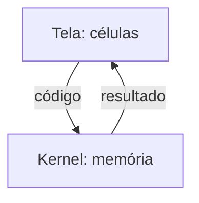
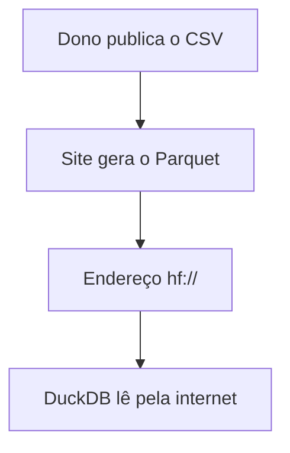
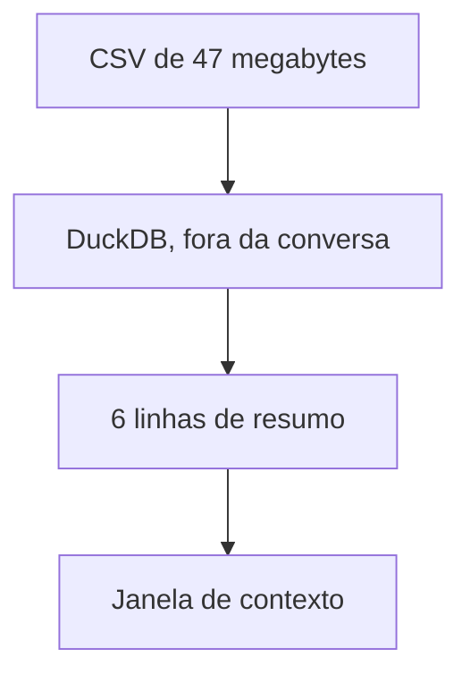

# DuckDB, formatos de arquivo, notebook e Hugging Face: como as peças se encaixam

Este guia explica, do zero, os formatos CSV, JSON, JSON Lines (JSONL) e Parquet, o DuckDB, o notebook e o papel do Hugging Face.  
Ele importa agora porque o Claude Code usa essas peças todos os dias.  
Ao final, você vai saber por que um arquivo grande fica fora da conversa e só o resumo entra.

## Antes de tudo: dado, tabela, arquivo e formato

Um dado é um fato anotado: "o pedido 1 foi para São Paulo e custou 564 reais" tem três dados.  
Uma tabela é uma grade: cada linha é uma coisa inteira (um pedido), e cada coluna é uma característica de todas as coisas (a cidade).  
Um arquivo tem nome e conteúdo, e a extensão (`.csv`, por exemplo) avisa o que tem dentro.  
Um formato é a regra de como escrever a tabela dentro do arquivo.

Arquivos de texto abrem em qualquer editor; arquivos binários (código de máquina, não letras) só fazem sentido para o programa certo.

Ponto-chave: formato é a regra de escrita da tabela no arquivo, e cada regra tem um custo diferente na hora de ler.

## CSV, JSON e JSONL escrevem a tabela linha por linha

Os três formatos de texto guardam a tabela uma linha de cada vez.  
Isso é bom para uma pessoa ler e para acrescentar um registro no fim.

### CSV: a planilha mais simples possível

CSV quer dizer "comma-separated values", valores separados por vírgula.  
Cada linha do arquivo é uma linha da tabela, a vírgula separa as colunas e a primeira linha traz os nomes das colunas.  
Tudo é texto, então o arquivo não diz se "564.31" é um número.

O problema: nunca existiu uma regra formal para o CSV, e cada programa grava de um jeito (vírgula ou ponto e vírgula).  
O documento público de referência (RFC 4180) registra essa falta de padrão.  
O que funciona: deixar o DuckDB ler uma amostra do arquivo e deduzir o separador e o tipo de cada coluna.

### JSON: uma ficha com etiquetas

JSON quer dizer "JavaScript Object Notation".  
É uma ficha em que cada valor tem uma etiqueta: `"cidade": "Recife"`.  
Chaves `{ }` abrem uma ficha, colchetes `[ ]` abrem uma lista, e uma ficha pode morar dentro de outra.  
O custo: cada ficha repete as etiquetas, então o arquivo cresce.

Você já usa JSON: o `settings.json` e o `.mcp.json` do Claude Code são arquivos JSON.

### JSONL: uma ficha JSON por linha

JSON Lines (JSONL) coloca uma ficha JSON completa em cada linha.  
Por isso o programa acrescenta uma linha no fim sem reescrever o arquivo, e esse é o formato comum de registros de eventos (logs).  
O Claude Code grava cada sessão em JSONL, uma mensagem por linha, em `~/.claude/projects/<projeto>/<sessão>.jsonl`.

Atenção: esses arquivos não têm proteção por senha, então uma senha que apareceu na tela fica gravada no arquivo da sessão.  
O que funciona: tratar a pasta `~/.claude/projects` como dado privado.

Ponto-chave: CSV, JSON e JSONL escrevem linha por linha, então o computador lê a linha inteira mesmo quando a pergunta usa uma coluna só.

## O Parquet guarda cada coluna em um bloco, e por isso lê menos

O Parquet inverte a ordem: escreve coluna por coluna, todas as cidades juntas, depois todos os valores.  
É um arquivo binário, então um editor de texto não abre.  
Em troca, somar uma coluna lê só o bloco daquela coluna, e os outros blocos ficam parados no disco.

O Parquet comprime bem, porque valores da mesma coluna se parecem: ele grava "pago, 3 vezes" em vez de "pago, pago, pago".  
E ele anota o número de linhas no fim do arquivo, por isso contar linhas é quase imediato.

Um teste com dados aleatórios, em uma máquina pequena e no DuckDB 1.5.6, mostra o ganho.  
Com 1 milhão de pedidos de seis colunas, o Parquet ficou 4 vezes menor que o CSV.  
Ele respondeu 12 vezes mais rápido à pergunta "total dos pedidos pagos por cidade", e o JSON deu o maior arquivo.

| Formato | Como escreve | Use quando |
|---|---|---|
| CSV | Texto, linha por linha, vírgula entre colunas | Uma pessoa vai abrir no editor ou no Excel |
| JSON | Texto, fichas com etiquetas | Os dados têm ficha dentro de ficha |
| JSONL | Texto, uma ficha JSON por linha | O arquivo cresce uma linha por vez (logs) |
| Parquet | Binário, coluna por coluna, comprimido | O arquivo é grande e serve para somar e contar |

Como ler: uma linha por formato, e a última coluna diz quando escolher esse formato.  
A escolha depende de quem vai ler o arquivo: uma pessoa, ou um programa que soma.

Ponto-chave: para somar uma coluna, o Parquet lê só o bloco daquela coluna, e o CSV obriga a ler todas as linhas inteiras.

## O DuckDB é um banco de dados sem servidor, que trata arquivos como tabelas

Para perguntar algo a uma tabela, a linguagem padrão é o SQL ("Structured Query Language").  
Uma consulta (query) tem quatro partes: `SELECT` (o que mostrar), `FROM` (de onde vem a tabela), `WHERE` (quais linhas entram) e `GROUP BY` (como agrupar).

```sql
SELECT cidade, round(sum(valor)) AS total
FROM 'pedidos.parquet'
WHERE status = 'pago'
GROUP BY cidade
ORDER BY total DESC;
```

Essa consulta lê 1 milhão de linhas e devolve 6: uma por cidade, com o total dos pedidos pagos.

### Programa, biblioteca e servidor

Um programa é código que você manda rodar.  
Uma biblioteca é código pronto que um programa carrega para dentro de si.  
Um servidor é um programa que fica ligado, esperando pedidos de outros programas.

A maioria dos bancos de dados é servidor: antes da primeira consulta no PostgreSQL, alguém instala o programa, liga o processo e cuida dele depois.  
O DuckDB é um banco de dados em forma de biblioteca.  
Ele responde SQL de dentro do programa que o chama, sem servidor para instalar, ligar ou manter.  
E ele lê CSV, JSON, JSONL e Parquet direto como tabelas: `FROM 'pedidos.csv'` já basta.

### Por que Parquet e DuckDB combinam

O DuckDB processa um lote grande de valores da mesma coluna por passo, na mesma lógica em que o Parquet grava.  
PostgreSQL, MySQL e SQLite processam uma linha por vez.  
Por isso os dois combinam: nem o Parquet nem o DuckDB gastam trabalho com colunas que a pergunta não usa.

Origem: Mark Raasveldt e Hannes Mühleisen criaram o DuckDB no centro de pesquisa de Amsterdã (CWI).  
O artigo de 2019 (na conferência SIGMOD) parte do SQLite, outro banco em biblioteca.

Ponto-chave: o DuckDB responde SQL de dentro do seu programa e lê o arquivo no lugar, então não existe servidor para instalar nem para manter.

## O notebook guarda variáveis na memória, na ordem dos cliques

Um notebook é uma lista de células, e o Jupyter é o programa mais conhecido para rodar notebooks.  
Uma célula é um bloco de texto ou de código que roda sozinho, quase sempre em Python.  
Uma variável é um nome que guarda um valor, como `total = 564`.

O kernel é o motor do notebook: o programa que executa as células e guarda as variáveis na memória.  
A tela envia o código da célula ao kernel e recebe o resultado de volta.  
O kernel só conhece o que as células já executadas criaram.



Como ler: as caixas são as duas partes do notebook, e as setas mostram o caminho do código e do resultado.  
A memória vive só no kernel, então a página é apenas uma janela para ela.

Daí vem o erro mais comum.  
Se você roda a célula que usa `total` antes da célula que cria `total`, o kernel não encontra a variável e dá erro.  
A memória do kernel segue a ordem dos seus cliques, não a ordem das células na página.  
O número entre colchetes ao lado de cada célula mostra a ordem real de execução.

Um estudo de Pimentel e colegas (Universidade Federal Fluminense e Universidade de Nova York, conferência MSR 2019) mediu o problema.  
Eles rodaram de novo cerca de 864 mil notebooks públicos do GitHub.  
Só 24 em cada 100 rodaram sem erro, e só 4 em cada 100 repetiram o mesmo resultado.  
As causas: bibliotecas faltando, memória escondida no kernel e células fora de ordem.

O que funciona: "Restart and Run All", que apaga a memória do kernel e roda todas as células de cima para baixo.  
Prática comum: explorar no notebook e, com a análise pronta, passar o código para um arquivo `.py`.

Ponto-chave: uma célula dá erro quando roda antes da célula que cria a variável, porque o kernel só conhece o que já executou.

## O Hugging Face hospeda datasets, e o DuckDB consulta pelo endereço hf://

O Hugging Face é um site que hospeda modelos de inteligência artificial (IA), conjuntos de dados (datasets) e aplicativos de demonstração.  
Um dataset tem dono e nome, como `stanfordnlp/imdb` (25 mil críticas de filmes), e pode ser público ou privado.

Quando alguém publica um dataset em CSV ou JSONL, o Hugging Face gera uma cópia em Parquet e guarda ao lado do arquivo original.  
O atalho `@~parquet` no endereço alcança essa cópia.  
O endereço `hf://datasets/<dono>/<nome>/<caminho>` liga o DuckDB ao dataset, e o asterisco no caminho significa "todos os arquivos que combinam".



Como ler: cada caixa é uma etapa (o site é o Hugging Face), e as setas seguem os dados do dono até a sua consulta.  
O DuckDB nunca precisa do CSV original, porque consulta a cópia em Parquet que o site já gerou.

Um teste pela internet mostra o custo.  
Contar as linhas de `stanfordnlp/imdb` levou cerca de 1 segundo, porque o Parquet anota o número de linhas no fim do arquivo.  
Medir o tamanho médio dos textos levou cerca de 6 segundos, porque os textos viajam pela internet.

"Sem download" precisa de contexto: o DuckDB não salva nenhum arquivo no seu computador, mas os dados necessários viajam pela internet a cada consulta.  
O que funciona: explorar pela internet e, quando achar o recorte certo, gravar uma cópia local pequena.

```sql
COPY (SELECT ... LIMIT 1000) TO 'recorte.parquet';
```

No lugar dos três pontos vai a sua consulta: o comando grava as primeiras 1.000 linhas do resultado em um Parquet local.  
Um dataset privado pede um token (uma senha longa criada no site), registrado no DuckDB uma vez.

Ponto-chave: o DuckDB lê um dataset publicado em CSV porque o Hugging Face gera a cópia em Parquet, e o endereço hf:// aponta para ela.

## Por que o Claude Code usa o DuckDB em vez de abrir o arquivo

A janela de contexto é a quantidade limitada de texto que o Claude lê em uma conversa.  
Um CSV de 47 megabytes não cabe nela.  
O DuckDB resolve lendo o arquivo fora da conversa e devolvendo só o resumo.



Como ler: as caixas são os lugares por onde os dados passam, e as setas mostram o caminho.  
O arquivo inteiro para no DuckDB, e a conversa recebe 6 linhas em vez de 1 milhão.

Três motivos explicam a escolha:

- Resposta pequena: 1 milhão de linhas entram no DuckDB, 6 voltam para a conversa.
- Sem servidor: um comando funciona em qualquer máquina.
- Uma consulta, qualquer formato: CSV, JSON, JSONL ou Parquet, sem converter antes.

### Sete comandos que cobrem quase todo o uso

Os exemplos usam o DuckDB 1.5.6, e o comentário antes de cada comando diz o objetivo.

```sql
-- 1. Ver as primeiras linhas, com os nomes das colunas
FROM 'pedidos.csv' LIMIT 3;

-- 2. Ver o nome e o tipo de cada coluna
DESCRIBE FROM 'pedidos.csv';

-- 3. Ver um resumo de cada coluna
SUMMARIZE FROM 'pedidos.csv';

-- 4. Ler todos os arquivos JSONL de uma pasta como uma tabela só
FROM read_ndjson('logs/*.jsonl');

-- 5. Contar mensagens por autor nos logs
SELECT message.role AS quem, count(*) FROM read_ndjson('logs/*.jsonl') GROUP BY ALL;

-- 6. Converter um CSV em Parquet
COPY (FROM 'pedidos.csv') TO 'pedidos.parquet';

-- 7. Em Python: guardar a tabela em um banco DuckDB no disco
-- duckdb.connect('loja.duckdb')
CREATE TABLE pedidos AS FROM 'pedidos.parquet';
```

Cada comando devolve uma tabela pequena na tela; o último grava o arquivo `loja.duckdb`, em que 1 milhão de pedidos ocuparam 5 megabytes.

Usos reais:

- Perguntar às suas sessões do Claude Code: `read_ndjson` sobre `~/.claude/projects/*/*.jsonl`, com `ignore_errors = true`.
- Preparar dados do TSE para um aplicativo sem internet, ou explorar um dataset antes de baixar.
- Guardar resultados de testes de IA em JSONL.  
  Ver sessões de agentes no Data Studio do Hugging Face, em dataset privado, porque pode haver senhas.

Ponto-chave: o Claude roda uma consulta do DuckDB porque o arquivo inteiro não cabe na janela de contexto, e o resumo cabe.

## Quando os dados não cabem na memória, o DuckDB usa o disco

Você já sabe que o DuckDB lê o arquivo fora da conversa.  
Falta um limite: a memória do computador (RAM) é menor que muitos arquivos.  
Quando a memória acaba no meio de uma consulta, o DuckDB grava dados temporários no disco e continua.

Isso resolve a maior parte dos casos, mas não todos: algumas consultas complexas ainda podem falhar por falta de memória.  
Um caminho que segue a lógica deste guia: pedir menos de uma vez, com menos colunas no `SELECT` ou um recorte com `LIMIT`.

Ponto-chave: o DuckDB usa o disco como memória de apoio quando a RAM acaba, e o limite são as consultas complexas que ainda falham.

## O que fica: o arquivo fica fora, o resumo entra

Agora as peças se encaixam.  
O Parquet guarda coluna por coluna, e o DuckDB processa uma coluna por passo: os dois leem só o que a pergunta usa.  
O DuckDB é uma biblioteca, então roda dentro de um notebook ou do Claude Code, sem servidor.  
No notebook, a memória vive no kernel, na ordem dos cliques, e "Restart and Run All" prova que a análise funciona.

O Hugging Face gera a cópia em Parquet, e o endereço hf:// leva o DuckDB até ela.  
E o Claude Code usa tudo isso por um motivo só: o arquivo inteiro não cabe na janela de contexto, mas 6 linhas cabem.

Ponto-chave: o dado fica no disco ou na internet, o DuckDB faz a conta lá, e só o resumo pequeno entra na conversa.
